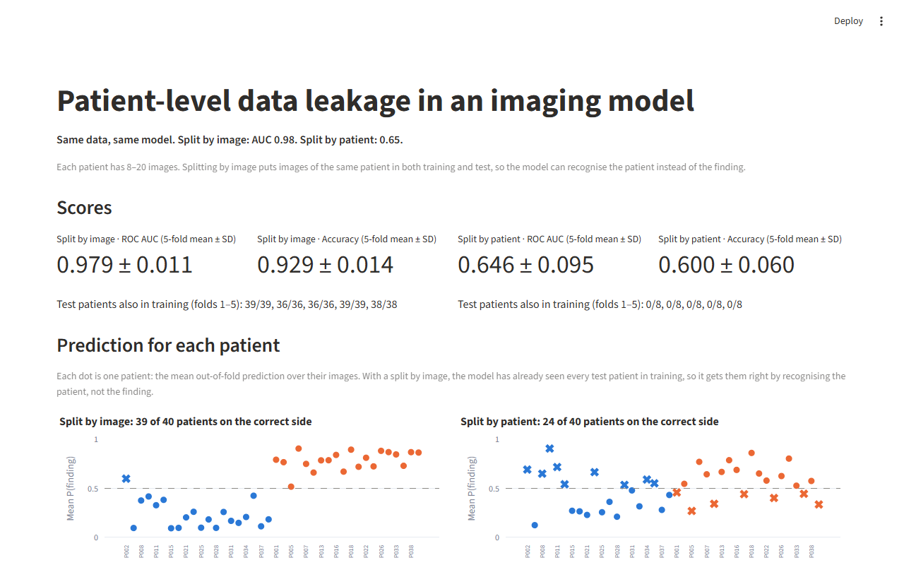
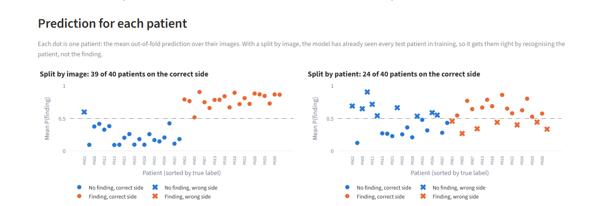
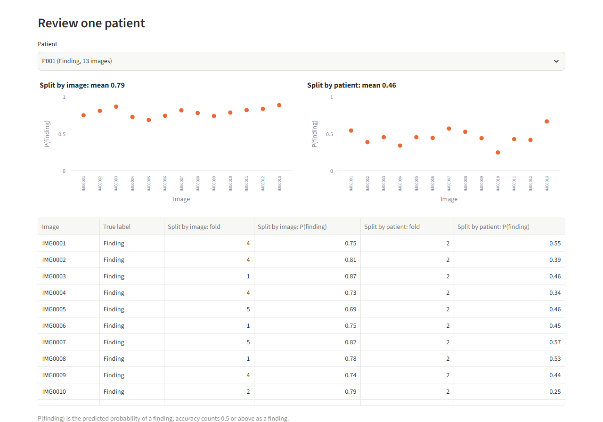

# Patient-level data leakage in an imaging model

When one patient has several images, splitting the data by image puts the same patient in both training and test, and the model looks far better than it is. This demo shows the effect on fully synthetic data: the same data and the same model score AUC 0.98 with an image-level split and 0.65 with a patient-level split.

**Live demo:** _link to be added after deployment_



## What happens

The model is a random forest (300 trees), evaluated with 5-fold cross-validation in two ways on the same data:

| Split | ROC AUC | Accuracy | Test patients also in training (folds 1–5) |
|---|---|---|---|
| By image (`StratifiedKFold`) | 0.979 ± 0.011 | 0.929 ± 0.014 | 39/39, 36/36, 36/36, 39/39, 38/38 |
| By patient (`StratifiedGroupKFold`) | 0.646 ± 0.095 | 0.600 ± 0.060 | 0/8, 0/8, 0/8, 0/8, 0/8 |

Mean ± sample standard deviation over the 5 folds; accuracy uses a 0.5 threshold.

With the image-level split, every test patient was also in training. The model does not need the weak real signal: it recognises the patient and returns that patient's label.



Each dot is one patient: the mean out-of-fold prediction over their images. A cross marks a patient on the wrong side of 0.5.

- Split by image: **39 of 40** patients are on the correct side.
- Split by patient: **24 of 40** patients are on the correct side. Whole patients land on the wrong side.

The app also lets you pick one patient and compare the per-image predictions from both splits:



With a patient-level split, each fold tests only 8 patients, so the fold AUC swings a lot (here from 0.545 to 0.743). The image-level folds look stable (0.965 to 0.990), but that stability comes from the leak.

## How to check it

**The patient offset is the cause.** Every feature is the sum of a fixed offset per patient, a weak signal shared by all patients with a finding, and noise per image. The same data can be generated again with the patient offset set to zero, keeping the labels, image counts and noise. The gap between the two splits disappears:

| Data | Split by image | Split by patient | Gap |
|---|---|---|---|
| Normal | 0.979 ± 0.011 | 0.646 ± 0.095 | 0.333 |
| Patient offset set to zero | 0.936 ± 0.016 | 0.937 ± 0.014 | −0.001 |

Compare only the two splits within the same data. Without the offset, patients no longer differ from each other, so the task itself is easier and both scores are higher; these scores say nothing about the normal data.

**The parameters were not picked to fit the story.** The signal strength and the image noise were chosen with `scripts/parameter_sweep.py`, which evaluates each setting on five data seeds. The seed of the demo (20261108) was fixed before tuning. Run the script to reproduce this table (it takes a few minutes):

| Signal | Image noise | Image-level AUC | Patient-level AUC (min – max over seeds) |
|---|---|---|---|
| 0.25 | 0.3 | 0.997 | 0.591 (0.502 – 0.757) |
| 0.35 | 0.3 | 0.998 | 0.657 (0.596 – 0.791) |
| 0.40 | 0.3 | 0.998 | 0.695 (0.652 – 0.796) |
| **0.40** | **0.5** | **0.975** | **0.690 (0.646 – 0.802)** (used) |
| 0.45 | 0.3 | 0.998 | 0.734 (0.688 – 0.808) |
| 0.55 | 0.3 | 0.999 | 0.803 (0.759 – 0.853) |
| 0.70 | 0.3 | 0.999 | 0.872 (0.851 – 0.898) |

Means over the seeds 20261108, 1, 2, 3 and 4. With noise 0.3 the image-level AUC is about 0.999, which looks unrealistic, so 0.5 was used. The patient-level AUC of the demo seed (0.646) is near the low end of its range across seeds.

The tests (`pytest`) also check that:

- the same seed gives an identical CSV;
- a patient-level split never puts one patient in both training and test, and an image-level split does;
- the image-level AUC is at least 0.2 higher than the patient-level AUC, and the gap is at most 0.05 without the patient offset;
- every image gets exactly one out-of-fold prediction;
- the Streamlit app renders to the end without exceptions.

## What to check in a real project

- **Split by the unit that repeats, not by row.** If a patient, subject, site or scanner appears in many rows, all of its rows belong on one side of the split. Here, splitting rows put every test patient in training and raised the AUC from 0.65 to 0.98.
- **Check for overlap before you report a score.** Count how many of these units appear in both training and test. In this demo the image-level split had 36–39 of 36–39 test patients in training in every fold; the patient-level split had 0 of 8.
- **With few units, report the spread, not only the mean.** A patient-level split leaves few patients in each test fold, so fold scores swing. Here each fold tested 8 patients and the fold AUC ranged from 0.545 to 0.743 (0.646 ± 0.095).

## About the data

- **All data is randomly generated.** There are no real patients, images or records.
- **No images are used.** Each "image" is a row of 10 numbers that stand in for features extracted from an image (`intensity_mean`, `texture_contrast`, `edge_density`, and so on). The demo does not load, process or learn from pixels. Real image features would not follow these simple distributions.
- 40 patients (20 with a finding, 20 without), 8–20 images each, 592 images in total. The label is set per patient, so all images of a patient share it.
- Each feature = patient offset (SD 1.0) + label signal (0.4, with a random sign per feature) + image noise (SD 0.5).
- Random seed 20261108. The app generates the data when it starts; it does not read or accept any files.

## Running it locally

Requires Python 3.12.

```bash
python -m venv .venv
# Windows: .venv\Scripts\activate    macOS / Linux: source .venv/bin/activate
pip install -r requirements.txt

streamlit run streamlit_app.py --server.address localhost
pytest
```

Other scripts:

```bash
python scripts/run_evaluation.py   # print the comparison tables
python scripts/generate_data.py    # write the two datasets to data/ as CSV (not committed)
python scripts/parameter_sweep.py  # reproduce the parameter sweep
```

## Project layout

```
streamlit_app.py            the app
src/leakage_demo/data.py    synthetic data generation
src/leakage_demo/evaluate.py  image-level and patient-level cross-validation
scripts/                    command-line scripts listed above
tests/                      pytest suites
docs/screenshots/           images used in this README
.streamlit/config.toml      Streamlit settings (usage statistics off)
```

CI (`.github/workflows/ci.yml`) installs `requirements.txt` and runs `pytest` on every push and pull request. It uses no secrets.
